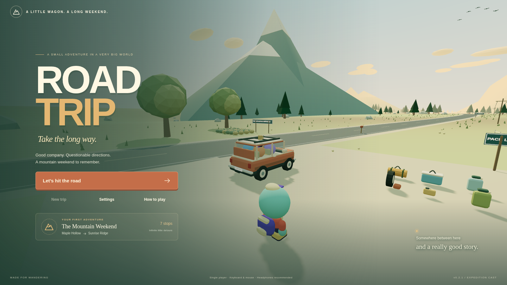
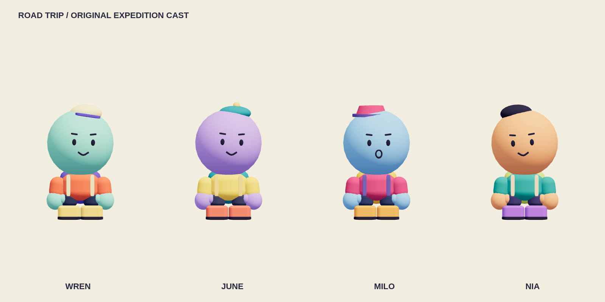
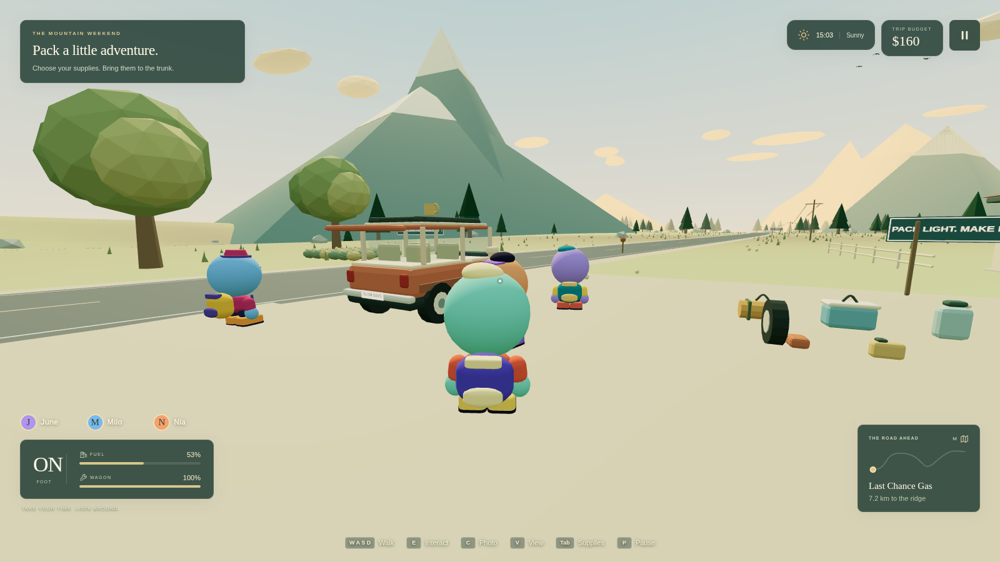

# ROAD TRIP

**A little wagon. A long weekend. Take the long way.**



An original, family-friendly 3D road-trip adventure with a third-person walking camera and optional first-person view. This repository contains a playable single-player vertical slice, **The Mountain Weekend**, built with TypeScript, Three.js, Vite, and Rapier. All art is generated from original compound geometry; sound effects and the quiet road-trip radio are synthesized locally. No remote art, music, game server, API key, or account is required.

## The 0.2.1 character rebuild

The four travelers have been rebuilt around giant spherical colored heads, dot/oval eyes, tiny mouths, little bean bodies, chunky tube arms, mitten hands, very short legs, and oversized boots. There are no noses, ears, hair meshes, or realistic facial features. The supplied reference guided the proportions; the models, palettes, faces, and accessories are original Road Trip designs.



| Traveler      | Head     | Shirt     | Boots     | Backpack      | Hat                  |
| ------------- | -------- | --------- | --------- | ------------- | -------------------- |
| Wren · player | Mint     | Coral     | Yellow    | Violet        | Tiny cream trail cap |
| June          | Lilac    | Sunflower | Coral red | Teal          | Little bobble hat    |
| Milo          | Sky blue | Raspberry | Orange    | Golden yellow | Tiny bucket hat      |
| Nia           | Apricot  | Teal      | Violet    | Lime          | Backward navy cap    |

Wren is the on-foot player; June, Milo, and Nia keep their existing companion roles. Roadside people use the same new design language. The old human-shaped models and first-person flesh-colored hands have been replaced. Existing trips and resources are retained.

Heads are about 1.77 times the torso width and more than twice its height; the spherical head diameter is over 55% of the whole standing character's height, including the hat. Backpacks form a broad, attached rounded shape behind the body. See the [back view](docs/characters-back.png), [black silhouette check](docs/characters-silhouettes.png), and [actual gameplay camera](docs/weekend.png).

The gameplay captures also include the [front view](docs/characters-gameplay-front.png) and [maximum walking-camera distance](docs/characters-gameplay-distance.png).

Animation adds floppy arm follow-through, big boot kicks, head wobble, leaning, squash on landing, and stretchy reaching around the oversized head. Hands retain their round mitten shape while arms stretch. The player and traveler colliders have been sized to the new heads, and carried objects sit at the new hand height. Small-step climbing, jumping, carrying, seating, and vehicle entry/exit retain their existing controls. Hanging/reaching poses are available to the animator; this character pass adds no new climbing mechanics.

To regenerate the front, back, silhouette, running, and reaching review images, start the development server and run `npm run review:characters` in another terminal. This uses the same character geometry and animator as the game. The browser character test checks the four identities, running and jumping, front/rear/distant camera views, and the larger head's clearance at a wall.

## The 0.2 polish update

- Responsive menus and a HUD with separate spaces for objectives, resources, passengers, interaction prompts, and notifications. Menus scroll inside the screen; gameplay overlays hide while browsing them.
- Articulated procedural character animation covers walking, running, jumping, landing, small steps, stumbling, carrying, sitting, and getting into and out of the wagon. The current models are the rebuilt 0.2.1 expedition cast shown above.
- A Rapier capsule controller with gravity, sliding, small-step climbing, and collision against terrain and approximately 3,800 visible-world shapes. Walls, fences, tree trunks, rocks, pumps, tables, signs, parked vehicles, and people are solid. Vehicle exits check for a clear place to stand. Loose supplies, cans, mugs, and souvenirs react to bumps and throws.
- A collision-aware walking camera with mouse-wheel zoom, an optional first-person view, and a collision-aware driving chase view. Indoors, the camera pulls forward and hides nearby head/backpack geometry.
- Material-specific footsteps, jump/landing, cloth, impact, pickup/drop/throw, vending, horn, brake, and engine sounds; wind, birds, insects, rain, tires, campfire, and radio share balanced audio buses and a master volume control.
- Three AI travel companions, roadside travelers with conversations, vending machines, resting benches, parked wagons, power lines, bird flocks, a crossing deer, and small physical junk. Loose roof cargo and a forgotten roof mug can produce accidental comedy.
- Spatially culled scenery, shared geometry/materials, sleeping physical props, and one rendered mesh per articulated character keep the extra detail bounded.

The existing packing, driving, fuel, repairs, route choice, camping, photographs, journal, rewards, replay, and saves remain part of the trip. Existing saves gain Nia as the third companion. This update does not add online multiplayer.



## Download and play

[Download the playable game](https://github.com/Cupcake5178/RoadTrip-Game/raw/refs/heads/main/downloads/RoadTrip-playable.zip), extract the ZIP, and open **RoadTrip.html** in a recent desktop Chrome, Edge, or Firefox browser. Click **Let's hit the road**. You do not need Node.js or terminal commands to play this version. Use a keyboard and mouse.

The download embeds the game, styles, physics, and generated art/audio into one HTML file. Browser saves stay on your device. See [download notes](downloads/README.md) for local-file restrictions and the development-server fallback.

## Run from source

Use Node.js 22.12+ (validated with Node.js 24) and npm:

```sh
npm ci
npm run dev
```

Open the address printed by Vite in a desktop browser with WebGL2, a keyboard, and a mouse. Click the game world to capture the mouse. Escape releases it; P opens the pause menu. Low graphics quality is available for slower machines and software rendering.

```sh
npm run build      # Type checking and a production build in dist/
npm run preview    # Serve the production build
npm test           # Simulation and persistence tests
npm run test:e2e   # Real Chromium gameplay tests
```

The browser tests use `/usr/bin/chromium` by default. Set `CHROMIUM_PATH` to use another installed Chromium. On a machine without Chromium, install it or run `npx playwright install chromium` and configure the executable path. No browser installation is needed to play the game in your usual browser.

## Your weekend

Start in Maple Hollow. Walk around the wagon, inspect the supplies, carry them to the trunk, and choose what fits into eleven cargo slots. Bring what matters: a tent, snacks, water, a spare, tools, a camera, fuel, or a weekend bag. Secure the roof straps, open the driver's door, and hop in.

The 7.2 km route passes through farmland, forests, a lake district, mountain country, and Little Spruce. A leisurely first trip with packing, exploration, repairs, and camping is designed around a 20–30 minute visit; this duration has not been validated with human playtests.

- **Last Chance Gas:** park at a pump, get out, and hold E to refuel. The convenience store has a walk-through entrance, shelves, supplies, snacks, water, and wagon servicing.
- **Mirror Lake:** explore the timber deck and take a real photograph for the journal. A packed camera earns scenic bonuses.
- **The Fork:** choose smooth highway or the bumpy Pinecone dirt loop. Your passengers have opinions about both.
- **Roadside surprises:** fix flats with packed tools and a spare, cool an overheating engine with water, or secure loose roof cargo. Missing equipment has a paid or patient alternative. There are four distance-triggered event opportunities, with seeded variation on replay.
- **Pinecone Camp:** pitch or rent a tent, light the contained fire, cook supper, meet a small campsite supervisor, and sleep until morning.
- **Little Spruce:** find the Big Little Teapot, stop at the diner, or rest at the motel.
- **Sunrise Ridge:** park and walk to the final overlook. Interact to receive a trip journal, photo album, rating, and travel rewards.

June (the planner), Milo (the happy camper), and Nia (the photographer) have lightweight hunger, energy, and mood needs. Share snacks through the cargo panel. They climb into the wagon with you and gather nearby when you get out. Weather changes between sun, cloud, rain, and fog; time advances through sunset, night, and sunrise. Headlights help in the dark.

Travel rewards purchase a bigger rack, better tires, and a tune-up. Paint colors are free. Rewards, upgrades, journals, and settings persist across new weekends. Finishing unlocks a golden-hour replay with a fresh event seed. The current vehicle is the Wander Wagon; additional vehicles and destinations are future work.

## Controls

| Key           | Action                                               |
| ------------- | ---------------------------------------------------- |
| WASD / arrows | Walk or accelerate, reverse, and steer               |
| Mouse / wheel | Look around / adjust third-person distance           |
| E             | Interact; open door / enter; exit when stopped       |
| Hold E        | Fuel, strap cargo, and perform repair steps          |
| Shift         | Sprint on foot                                       |
| Space         | Jump on foot / handbrake while driving               |
| Q / G         | Put down / throw a carried item                      |
| F             | Toggle headlights                                    |
| H             | Honk the wagon horn                                  |
| V             | First / third person on foot; cockpit / chase in car |
| C             | Frame a photo; press again to keep it                |
| M             | Route and discoveries                                |
| Tab           | Cargo, snacks, water, and emergency fuel             |
| P / Escape    | Pause / release mouse                                |
| R             | Friendly roadside assistance, up to $8               |

Look toward an item or interaction to reveal its prompt. Open the trunk before packing. For a flat, retrieve the packed spare and tool kit, hold E to jack up the wagon, then hold E again to fit the spare. With no supplies, the same wheel prompt offers roadside service. Assistance and rental fallbacks keep an empty wallet from ending the weekend.

E also talks to travelers, buys two snacks for $3 at a vending machine, and sits on marked benches. Press E or move to stand up. Carry small roadside objects with E and throw them with G. Most scenery remains scenery; benches, travelers, machines, and pickup props show a prompt when usable. Settings supports native Tab navigation and arrow-key slider adjustments.

## Saving

The trip saves automatically every twelve active seconds, at significant actions, when pausing, and when returning to the title screen. Continue resumes resources, vehicle position, decisions, discoveries, photographs, and progression. New Trip replaces the active trip while keeping earned progression; Reset Save removes all progress and settings after confirmation.

Saves live in this browser's local storage. There are eight photographs per trip and three retained completed journals. Unpacked loose items are session-only; keep important items packed before leaving. If storage is blocked or full, the game warns that progress is in memory only. There is no cloud sync.

## Architecture

- `src/game.ts`: game loop, player movement, interaction dispatch, repair steps, trip flow, and camera.
- `src/vehicle.ts`: accessible arcade driving, terrain alignment, scenery contacts, fuel, cockpit/chase views, visual suspension/sway, roof cargo, and vehicle problems.
- `src/world.ts`: road ribbons, colored terrain, instanced vegetation, spatially batched scenery, detailed stops, lighting, weather, and campsite.
- `src/models.ts`: recognizable compound models, shared materials, signs, the wagon interior, supplies, and an asset registry with a GLTF loader.
- `src/character.ts` and `src/character-skin.ts`: four original cast designs and palettes, a small bone hierarchy, combined skinned geometry, and procedural animation.
- `src/collision.ts`: spatially indexed visible-world shapes, swept collision queries, and scenery contact resolution.
- `src/physics.ts`: Rapier terrain/static collision, the capsule character controller, vehicle/NPC bodies, and dynamic dropped/thrown supplies.
- `src/follow-camera.ts`: swept shoulder-camera placement, zoom, and smoothing around obstructions.
- `src/roadside-life.ts`: travelers, interactive props, benches, vending machines, birds, deer, and roadside detail.
- `src/state.ts`: serializable state, inventory, budget, rewards, seeded event choices, persistence, and progression.
- `src/route.ts`: continuous road geometry, stop data, terrain sampling, and seeded randomness.
- `src/ui.ts` and `src/style.css`: game HUD, menus, map, settings, shops, and journal.
- `src/audio.ts`: procedural music, engine, rain, footstep, interaction, repair, and photo sounds.

Vehicle handling intentionally uses a forgiving arcade terrain-following controller with scenery contact resolution. Rapier handles the player capsule and loose supplies; this is not a full rigid-body suspension or ragdoll simulation. Characters use original articulated rigs with procedural animation. Climbing covers small steps and terrain slopes, rather than free climbing or mountaineering.

The asset registry exposes `loadAsset()` for original `.glb` / `.gltf` replacements. Preserve the model's scale, forward direction (-Z), interaction root, and anchor positions when replacing its visual children. The gameplay data and interactions are independent of a specific mesh. New vehicles should implement the existing vehicle anchors and use separate stat definitions; multiplayer is not implemented.

## Validation

The 24 unit tests cover cargo capacity, repacking exploits, fuel pricing, budgets, passenger resources, discovery uniqueness, deterministic events, reward idempotency, replay progression, save round-trips, corrupt/unavailable storage, and continuous road/stop geometry. They also check thin and rotated obstacle collision, vertical clearance, camera corner sweeps, actual Rapier walking/jumping and thrown-object contacts, safe vehicle exit clearance, dramatically oversized spherical heads, small bodies, four color identities, and reaching hands clearing the head without stretching their mitten shape.

The 14 Chromium browser tests use actual keyboard interactions to pick up and pack supplies, enter and drive the wagon, solve vehicle problems with and without supplies, pay for fuel, buy supplies, take WebGL photographs, choose a route, pitch/light/cook/sleep at camp, visit an attraction, complete the trip, reload saved progress, and replay. Additional checks cover settings, dropped cargo, reset, all 14 menu states and a busy HUD at **1920×1080, 1600×900, and 1366×768**, walking/jumping against representative world obstacles, trunk/rock clearance while sliding around them, throwing, conversations, vending, seating, indoor camera collision, safe exits when parked beside a wall, generated audio output/muting, the rebuilt characters from the actual third-person camera, and moving companions clearing the view while they step out. Keyboard sliders and braking feedback have regression checks.

The development-only `?test` travel harness shortens long drives and aims the camera; it does not grant supplies, fix problems, or complete trips. It is excluded from production builds. Layout screenshots are also inspected visually. Tests use software-rendered Chromium in the cloud, so they demonstrate functionality rather than a gaming-PC frame-rate benchmark. Distant scenery is culled by spatial groups and test scenes enforce draw/triangle budgets. These checks do not establish that every possible contact across the whole map is flawless.

Each articulated character is combined into one skinned mesh: the four-character review scene uses four draw calls and approximately 34,650 triangles. This is a scene-complexity measurement, not a frame-rate promise. The standalone ZIP is also checked separately: production test hooks are absent, the game makes no external resource requests, and a captured photograph survives saving and reloading.

The production build's largest chunk contains Rapier's embedded WebAssembly. It is self-contained and needs no separate WASM host. Vite's default large-chunk warning is expected for this dependency.

## Current scope

This is one complete single-player trip with three AI friends and an original procedural art and sound direction. Online co-op, additional drivable vehicles, a larger world, ragdoll physics, free climbing, detailed mechanical simulation, and touch/controller controls are not included. The architecture separates input, simulation, world, assets, and presentation so later work can build on the slice.
